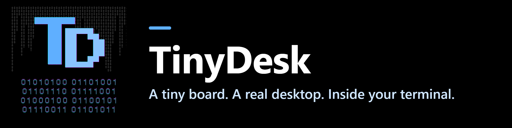

<p align="center"></p>

v0.2.0 · Developer preview.

**[Install it from the browser](https://tinydesk-project.github.io/install/)**: flash an ESP32 (Chrome or
Edge, no toolchain), or download the Windows and Linux programs. Then open
the board in the **[web terminal](https://tinydesk-project.github.io/console/)**, or in PuTTY.
Full **[documentation](https://tinydesk-project.github.io/)**. To build from source, see below.

Desktop [accounts and kiosk login](docs/ACCOUNTS.md),
[generated bitmap fonts](docs/BITMAP_FONTS.md), and
[GUI rendering and page caching](docs/GUI_PERFORMANCE.md) have local guides.


*One continuous take from an ESP32 over USB serial, at normal speed: Editor,
Files, System Monitor and Terminal are opened, dragged and resized side by
side, then About. The board runs the desktop; the computer only displays it.
[Watch the MP4](docs/media/desktop-demo-esp32.mp4) or read the
[capture details](docs/media/README.md).*

TinyDesk draws overlapping, draggable text-mode windows with ANSI escape
sequences and reads the keyboard and mouse back from the terminal. There is
no display hardware: open a UTF-8 terminal with ANSI/VT cursor control
and xterm mouse reporting (for example, configured PuTTY) on the board's serial
port and you get a desktop, with a full shell,
[TinyDesk Shell](https://github.com/tinydesk-project/tinydesk-shell), in a
Terminal window. The core is portable C11; ports exist for ESP32 boards
(ESP-IDF), Linux and Windows, and a new target needs four functions.

* Pure C11 core with no third-party dependencies. Screen buffers are allocated
  at initialization; pasted text can grow a heap buffer with `realloc()`.
  Only changed cells are sent each frame.
* Runs on the **ESP32-C6** (built-in USB port), the **classic ESP32** and
  the **ESP32-S3** (USB-UART, 921600 baud, PSRAM boards), and natively in
  Windows, Linux and macOS terminals for development.
* On the ESP32-S3, a USB keyboard and mouse can also be plugged into the
  board itself (`usb.host = 1`), with Windows-key shortcuts.
* Kiosk mode: one Python app on the whole screen instead of the desktop
  (`kiosk.app`), for operator panels; root's password leaves it.
* Two displays (Settings -> Displays): the board's own link, Telnet
  clients or a second serial port, duplicated or extended on any side,
  each with its own resolution (and the CrowPanel's LCD turned); windows
  move between them with Alt+Shift+Left / Right.
* Windows with z-order, drag, resize, minimise, maximise; taskbar, start
  menu, mouse and keyboard; copy and paste with the PC; screen size follows
  the terminal. Desktop icons that stay where they are dragged, shortcuts
  (Send to Desktop), each user's Start menu entries and `~/Apps` folder.
* Apps: Terminal (the shell), Files, Editor, Network, MQTT, Modbus (TCP and
  RTU), Task Manager, System Monitor, Log Viewer, Settings, Users
  (accounts, Admin and User roles, rights, password hints), Recycle Bin
  (restore what was deleted), Search (Alt+S: apps, files, folders), Software Update
  (OTA), Pixels, Image Viewer (BMP, PPM, PGM), Mouse and Keyboard (with USB
  on the ESP32-S3), On-screen keyboard (large touch keys), Store (installs
  apps from the tinydesk-apps catalog), Remote Desktop (another TinyDesk's
  desktop in a window, over Telnet), and a small API for writing your own, with a pixel
  canvas (`td_canvas.h`: two pixels per cell in any terminal, four with a
  font that has the quadrant characters).
* Shell scripts (`.tdsh`): variables, `if`/`while`/`for`, functions, pipes
  and redirection, run from the Terminal or with right-click → Run on the
  desktop. Language reference: `docs/SCRIPTING.md` in
  [TinyDesk Shell](https://github.com/tinydesk-project/tinydesk-shell).
* Python scripts with [MicroPython](https://micropython.org): `py script.py`
  in the Terminal, or `py` for the interactive prompt. Scripts read and
  write TinyDesk's files, and the `tinydesk` module runs shell commands,
  publishes MQTT messages and reads or writes Modbus registers. `asyncio`
  runs several jobs in one script, and precompiled `.mpy` files load too.
  On the boards, root's scripts drive pins and buses with `machine` (Pin,
  ADC, PWM, I2C, SPI, UART, NeoPixel LEDs); pins TinyDesk uses are refused.
  With `tdui` a script opens windows of its own (buttons, text boxes,
  lists, canvases, dialogs) and handles them in Python.
  `with canvas.batch():` groups visible drawing without intermediate
  frames (a 1000 ms deadline releases an unfinished group); `canvas.bar()`
  repaints a meter in one request. Canvas buttons belong to their page.
  The Editor colours Python, runs the file with F5 (output underneath),
  goes to the line of an error and suggests names.
* Optional, root-only desktop takeover over unencrypted Telnet. SSH provides
  an encrypted shell and SFTP, not the windowed desktop. FTP, SMB mounts,
  Wi-Fi and W6100 Ethernet are available from the shell.

## Choose a target

| Desktop target | Hardware | Console / limits |
| --- | --- | --- |
| ESP32-S3 with PSRAM | 16 MB flash, Octal PSRAM | USB-UART, 921600 baud |
| ESP32-C6 | 8 MB flash | Built-in USB Serial/JTAG |
| Classic ESP32 with PSRAM | 16 MB flash, PSRAM required | USB-UART, 921600 baud |
| Classic ESP32, 4 MB | PSRAM optional | USB-UART, 921600 baud; 80×25, no SSH server or OTA |
| Elecrow CrowPanel 7.0 | ESP32-S3, 4 MB flash, 8 MB PSRAM | The desktop on its 800×480 touch LCD (100×30 cells, larger text with `lcd.font`), keyboard on UART0 at 921600 baud; kiosk HMIs; no OTA (one app slot) |
| Arduino Nano ESP32 | ESP32-S3, 16 MB flash, 8 MB Octal PSRAM | Built-in USB Serial/JTAG on its USB-C port; no USB keyboard; community port by [aquasock](https://github.com/aquasock) |
| PC | Linux, Windows with MinGW, or macOS | Compatible terminal; host simulator for development |

[TinyDesk Shell](https://github.com/tinydesk-project/tinydesk-shell) also runs as
standalone firmware or a POSIX host program. Every
[release](https://github.com/tinydesk-project/tinydesk/releases) has the firmware
images for both editions, the PC programs and `SHA256SUMS.txt`; the
[web installer](https://tinydesk-project.github.io/install/) uses the same files.

### Community ports

Maintained by their authors, not built or tested here:

| Port | Hardware | Notes |
| --- | --- | --- |
| [TinyTang](https://github.com/aquasock/TinyTang) by [@aquasock](https://github.com/aquasock) | BL616 on the Sipeed Tang Console 138K | Desktop over USB CDC, SD card as filesystem; loads FPGA cores and ROMs from the shell |

## First connection

Open the board's serial port (any speed on the ESP32-C6; 921600 baud for
the desktop on the ESP32 and ESP32-S3, 115200 for the shell) and press a key. Sign in
as root. Run `passwd` locally (old password: **`TinyDesk`**) before enabling
remote access. Telnet starts **disabled** and requires an explicit Network
setting. Telnet, SSH and FTP refuse remote authentication while the factory
root password remains. After any Telnet takeover, physical `rootrecover`
requires a local reboot; disconnecting does not restore recovery privileges.

## Build from source

The shell is a git submodule, so clone with `--recursive`:

```bash
git clone --recursive https://github.com/tinydesk-project/tinydesk.git
cd tinydesk
```

(Already cloned without it? `git submodule update --init`.)

| Target | Commands |
| --- | --- |
| Desktop on the PC (Linux, macOS, WSL, Windows with MinGW) | `cmake -B build -G Ninja && cmake --build build && ./build/tinydesk` |
| ESP32-S3 with PSRAM, ESP-IDF 5.3.1 | `cd ports/esp32s3 && idf.py build && idf.py -p PORT -b 921600 flash` |
| ESP32-C6, ESP-IDF 5.3.1 | `cd ports/esp32c6 && idf.py build && idf.py -p PORT flash` |
| Classic ESP32 with PSRAM, ESP-IDF 5.3.1 | `cd ports/esp32 && idf.py build && idf.py -p PORT -b 921600 flash` |
| Classic ESP32, 4 MB flash, no PSRAM | `cd ports/esp32-4mb && idf.py build && idf.py -p PORT -b 921600 flash` |
| Elecrow CrowPanel 7.0, ESP-IDF 5.3.1 | `cd ports/crowpanel7 && idf.py build && idf.py -p PORT -b 921600 flash` |
| Arduino Nano ESP32, ESP-IDF 5.3.1 | `cd ports/nanoesp32 && idf.py build && idf.py -p PORT flash` (read `ports/nanoesp32/README.md` first) |

Step-by-step instructions, terminal settings and troubleshooting are in the
[getting started guide](docs/GETTING_STARTED.md).

## Your board's pins

Pins are not in the code. RS-485 lines, W6100 Ethernet, the SD card, the
ESP32's console UART and the ESP32-S3's USB keyboard and mouse come from a
small `key = value` file:

```bash
cd ports/esp32c6
cp board.example.conf board.conf     # your wiring; board.conf is in .gitignore
```

On a running board, `board set rs485.1.tx 16` (as root) does the same
without a rebuild. See
[example board configuration](ports/esp32c6/board.example.conf).

## Repositories

| Repository | What it is | Licence |
| --- | --- | --- |
| **tinydesk** (this one) | the desktop, apps, ports and tools | MIT |
| [**tinydesk-shell**](https://github.com/tinydesk-project/tinydesk-shell) | TinyDesk Shell (`tdsh`): the shell, its ESP-IDF services and host port; included here as the submodule `third_party/tdsh` | MIT, with third-party parts under their own licences |

## Licence

TinyDesk is released under the [MIT licence](LICENSE).

The firmware images also contain third-party code under its own licence,
notably **wolfSSH and wolfSSL (GPLv3)** for the SSH/SFTP server. Firmware
built with them, including the prebuilt releases, is therefore distributed
under the terms of the GPLv3 as a whole. The source code in this repository
stays MIT. See [`third_party/tdsh/THIRD_PARTY_LICENSES.md`](third_party/tdsh/THIRD_PARTY_LICENSES.md)
for the list. The `py` command is [MicroPython](third_party/tdsh/third_party/micropython/README.md)
(MIT; its SHA-256 code from `lib/crypto-algorithms` is public domain), which
comes with TinyDesk Shell (`third_party/tdsh/third_party/micropython`, its
port in `third_party/tdsh/python`); TinyDesk adds its own modules in
`ports/common/python`. The pixel text of Python windows uses glyphs of the
console font Uni2-VGA16 by Dmitry Bolkhovityanov (MIT), in
`apps/pyui_font.c`. The CrowPanel's larger LCD fonts are made from
Terminus Font by Dimitar Toshkov Zhekov (SIL Open Font License 1.1,
[`ports/crowpanel7/main/OFL-Terminus.txt`](ports/crowpanel7/main/OFL-Terminus.txt)).

## Contributing

Bug reports and pull requests are welcome: see [CONTRIBUTING.md](CONTRIBUTING.md).
The people who made TinyDesk are listed in [CONTRIBUTORS.md](CONTRIBUTORS.md).
Security problems: please report them privately (GitHub → Security →
Report a vulnerability), see [SECURITY.md](SECURITY.md).

Canvas buttons also support press, release and cancel handlers. Keyed picture corners retain their actual canvas background; load UI skins with `dither=False` for clean fills. See [hardware and Studio validation](docs/TDUI_VALIDATION.md) for the COM19/COM22 checks and the Studio `examples/button_events.json` starter.
