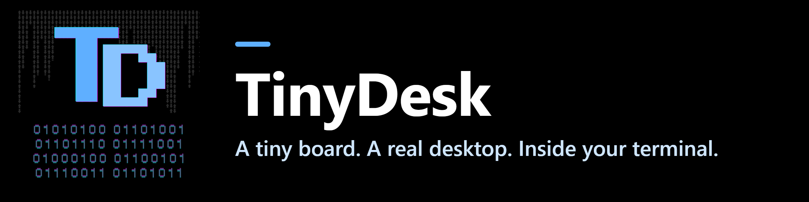

<p align="center"></p>

v0.1.6 · Developer preview.

**[Install it from the browser](https://tinydesk-project.github.io/install/)**: flash an ESP32 (Chrome or
Edge, no toolchain), or download the Windows and Linux programs. Then open
the board in the **[web terminal](https://tinydesk-project.github.io/console/)**, or in PuTTY.
Full **[documentation](https://tinydesk-project.github.io/)**. To build from source, see below.


*One continuous take from an ESP32 over USB serial, at normal speed: Editor,
Files, System Monitor and Terminal are opened, dragged and resized side by
side, then About. The board runs the desktop; the computer only displays it.
[Watch the MP4](docs/media/desktop-demo-esp32.mp4) or read the
[capture details](docs/media/README.md).*

TinyDesk draws overlapping, draggable text-mode windows with ANSI escape
sequences and reads the keyboard and mouse back from the terminal. There is
no display hardware: open a UTF-8 terminal with ANSI/VT cursor control
and xterm mouse reporting (for example, configured PuTTY) on the board's serial
port and you get a desktop, with a full shell,
[TinyDesk Shell](https://github.com/tinydesk-project/tinydesk-shell), in a
Terminal window. The core is portable C11; ports exist for ESP32 boards
(ESP-IDF), Linux and Windows, and a new target needs four functions.

* Pure C11 core with no third-party dependencies. Screen buffers are allocated
  at initialization; pasted text can grow a heap buffer with `realloc()`.
  Only changed cells are sent each frame.
* Runs on the **ESP32-C6** (built-in USB port) and the **classic ESP32**
  (USB-UART, 921600 baud, PSRAM boards), and natively in Windows, Linux and
  macOS terminals for development.
* Windows with z-order, drag, resize, minimise, maximise; taskbar, start
  menu, mouse and keyboard; copy and paste with the PC; screen size follows
  the terminal.
* Apps: Terminal (the shell), Files, Editor, Network, MQTT, Modbus (TCP and
  RTU), Task Manager, System Monitor, Log Viewer, Settings, Software Update
  (OTA), and a small API for writing your own.
* Shell scripts (`.tdsh`): variables, `if`/`while`/`for`, functions, pipes
  and redirection, run from the Terminal or with right-click → Run on the
  desktop. Language reference: `docs/SCRIPTING.md` in
  [TinyDesk Shell](https://github.com/tinydesk-project/tinydesk-shell).
* Optional, root-only desktop takeover over unencrypted Telnet. SSH provides
  an encrypted shell and SFTP, not the windowed desktop. FTP, SMB mounts,
  Wi-Fi and W6100 Ethernet are available from the shell.

## Choose a target

| Desktop target | Hardware | Console / limits |
| --- | --- | --- |
| ESP32-S3 with PSRAM | 16 MB flash, Octal PSRAM | USB-UART, 921600 baud |
| ESP32-C6 | 8 MB flash | Built-in USB Serial/JTAG |
| Classic ESP32 with PSRAM | 16 MB flash, PSRAM required | USB-UART, 921600 baud |
| Classic ESP32, 4 MB | PSRAM optional | USB-UART, 921600 baud; 80×25, no SSH server or OTA |
| PC | Linux, Windows with MinGW, or macOS | Compatible terminal; host simulator for development |

[TinyDesk Shell](https://github.com/tinydesk-project/tinydesk-shell) also runs as
standalone firmware or a POSIX host program. Every
[release](https://github.com/tinydesk-project/tinydesk/releases) has the firmware
images for both editions, the PC programs and `SHA256SUMS.txt`; the
[web installer](https://tinydesk-project.github.io/install/) uses the same files.

### Community ports

Maintained by their authors, not built or tested here:

| Port | Hardware | Notes |
| --- | --- | --- |
| [TinyTang](https://github.com/aquasock/TinyTang) by [@aquasock](https://github.com/aquasock) | BL616 on the Sipeed Tang Console 138K | Desktop over USB CDC, SD card as filesystem; loads FPGA cores and ROMs from the shell |

## First connection

Open the board's serial port (any speed on the ESP32-C6; 921600 baud for
the desktop on the ESP32, 115200 for the shell) and press a key. You start
as root. Run `passwd` locally (old password: **`TinyDesk`**) before enabling
remote access. Telnet starts **disabled** and requires an explicit Network
setting. Telnet, SSH and FTP refuse remote authentication while the factory
root password remains. After any Telnet takeover, physical `rootrecover`
requires a local reboot; disconnecting does not restore recovery privileges.

## Build from source

The shell is a git submodule, so clone with `--recursive`:

```bash
git clone --recursive https://github.com/tinydesk-project/tinydesk.git
cd tinydesk
```

(Already cloned without it? `git submodule update --init`.)

| Target | Commands |
| --- | --- |
| Desktop on the PC (Linux, macOS, WSL, Windows with MinGW) | `cmake -B build -G Ninja && cmake --build build && ./build/tinydesk` |
| ESP32-S3 with PSRAM, ESP-IDF 5.3.1 | `cd ports/esp32s3 && idf.py build && idf.py -p PORT -b 921600 flash` |
| ESP32-C6, ESP-IDF 5.3.1 | `cd ports/esp32c6 && idf.py build && idf.py -p PORT flash` |
| Classic ESP32 with PSRAM, ESP-IDF 5.3.1 | `cd ports/esp32 && idf.py build && idf.py -p PORT -b 921600 flash` |
| Classic ESP32, 4 MB flash, no PSRAM | `cd ports/esp32-4mb && idf.py build && idf.py -p PORT -b 921600 flash` |

Step-by-step instructions, terminal settings and troubleshooting are in the
[getting started guide](docs/GETTING_STARTED.md).

## Your board's pins

Pins are not in the code. RS-485 lines, W6100 Ethernet, the SD card and
the ESP32's console UART come from a small `key = value` file:

```bash
cd ports/esp32c6
cp board.example.conf board.conf     # your wiring; board.conf is in .gitignore
```

On a running board, `board set rs485.1.tx 16` (as root) does the same
without a rebuild. See
[example board configuration](ports/esp32c6/board.example.conf).

## Repositories

| Repository | What it is | Licence |
| --- | --- | --- |
| **tinydesk** (this one) | the desktop, apps, ports and tools | MIT |
| [**tinydesk-shell**](https://github.com/tinydesk-project/tinydesk-shell) | TinyDesk Shell (`tdsh`): the shell, its ESP-IDF services and host port; included here as the submodule `third_party/tdsh` | MIT, with third-party parts under their own licences |

## Licence

TinyDesk is released under the [MIT licence](LICENSE).

The firmware images also contain third-party code under its own licence,
notably **wolfSSH and wolfSSL (GPLv3)** for the SSH/SFTP server. Firmware
built with them, including the prebuilt releases, is therefore distributed
under the terms of the GPLv3 as a whole. The source code in this repository
stays MIT. See [`third_party/tdsh/THIRD_PARTY_LICENSES.md`](third_party/tdsh/THIRD_PARTY_LICENSES.md)
for the list.

## Contributing

Bug reports and pull requests are welcome: see [CONTRIBUTING.md](CONTRIBUTING.md).
Security problems: please report them privately (GitHub → Security →
Report a vulnerability), see [SECURITY.md](SECURITY.md).
